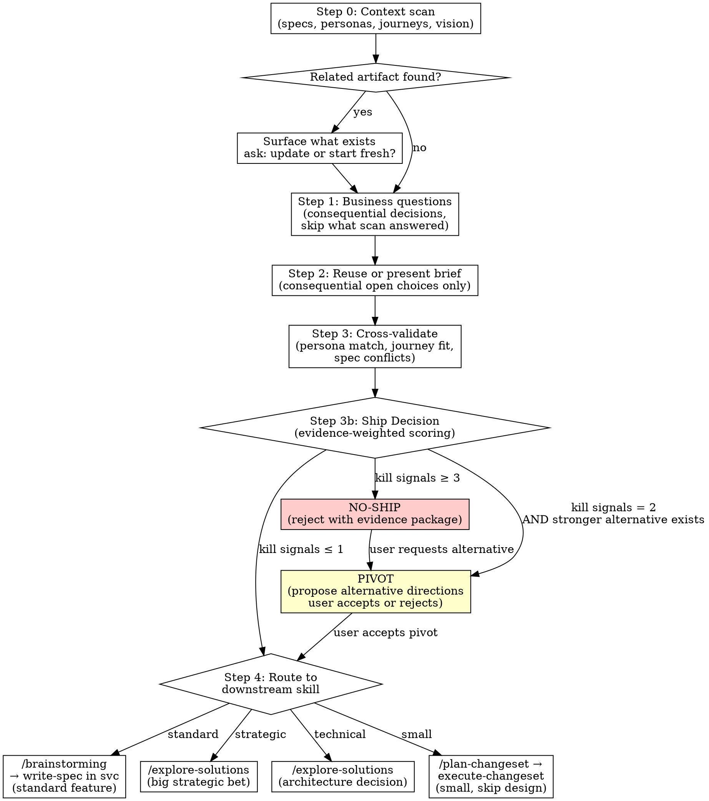

# Feature Discovery

## Overview

Turn a raw feature idea into a validated, cross-referenced business brief before any technical
design begins. The output is a Feature Ship Brief — a permanent product-layer document that
captures the strategic bet, user problem, success condition, and MVP hypothesis.

This skill does three things that jumping straight to design misses:
1. **Checks what already exists** — specs, personas, journeys that relate to this idea
2. **Validates the business case** — evidence-backed business dimensions and unresolved consequential choices
3. **Routes to the right next skill** — based on what the discovery learned

**Core principle:** Understand why before how. A feature that solves the wrong problem
perfectly is worse than no feature at all.

**Announce at start:** "I'm using validate-feature to validate this idea before we design anything."

## Product Questions — shared format

Ground the business case in current owner scope, persona/journey/spec evidence and actual relevant code. Follow `_shared/product-question-format.md` with `phase: validate-feature`. Reuse accepted decisions and task authorization; ask only unresolved consequential owner choices. Record real decisions in the existing companion or canonical decision artifact. No empty companion or numeric question floor is required. Unresolved consequential decisions block dependent work.

## Repository Mode Gate

Before Step 0, detect repository mode from `REPO_MODES.md` and state it.

- `bootstrap`: if personas/journeys/specs do not exist yet, produce an initialization brief
  and route to `write-vision` → `analyze-domain` → `build-personas` to scaffold first.
- `convert`: validate ideas against existing repo artifacts and map findings to current
  structure before proposing consolidation.

<HARD-GATE>
Before proposing implementation, ground the problem, intended user outcome and scope in the context scan and Feature Ship Brief. Reuse an existing accepted brief or clear founder instruction for an already-authorized bounded change. Cover relevant business dimensions from evidence; only unresolved consequential choices require owner input. Do not ignore supplied technical facts, repeat answered questions, or insist on new confirmation of existing authorization. Missing consequential evidence or conflicting scope blocks dependent work under the shared promotion predicate.
</HARD-GATE>

---

## Before Starting

Read (in order, only as needed for this run):
- `docs/specs/project-state.md` — current pipeline state, active feature, lane
- `~/.svc/builder-profile.md` — builder context, stack, prior decisions
- `docs/specs/domain-profile.md` — industry conventions, framework constraints
- existing feature specs at `docs/specs/features/*.md` — to detect duplicate intent before validation begins

Read **as needed**, not all 4 unconditionally. See `_shared/before-starting.md` for the canonical chain documentation.

---

## Process



---

**0. Task Graph Setup** — Before any validation work, make sure `.svc/lane-tasks-<WI>.json` has a Task {T} with nine `process_tasks` ({T}.1 context-scan through {T}.9 finalize). If the file and process_tasks exist, skip setup and just hydrate; if the file exists without process_tasks, add them to Task {T} only (never overwrite the file); if no file exists, run `node scripts/task-graph.mjs init .svc/lane-tasks-<WI>.json --wi <WI-###> --lane feature` and populate it. Set status with `node scripts/task-graph.mjs set-status .svc/lane-tasks-<WI>.json {T} completed` (and the same for each process task), update the file before the task system on each completion, and never mark Task {T} completed until all nine process tasks are completed or skipped ({T}.3-{T}.7 may be skipped only on the escape-check path). Details: `references/process.md`.

## Step 0: Context Scan

For concept fragmentation, an existing pipeline break, or a missing journey describing existing functionality, P2 reuses the established expected behavior and skips P3–P5 when no new consequential business uncertainty exists. Route to diagnose-bug, plan-changeset, write-journeys or audit-ac according to the actual gap; retain relevant dependency and spec/code conflict checks.

**Apply the context-scan result to the existing graph:** P2 records whether P3–P5 apply and why. For a bounded authorized change with sufficient current evidence, mark non-applicable process tasks using the existing conditional-skip convention and continue relevant cross-validation and routing. Do not fabricate executed phase receipts or new brief artifacts. A new idea, missing consequential evidence, or a material conflict still requires the applicable business work; authorization alone is not evidence of demand. P6 accepts the existing brief or canonical owner scope as its routing input.

Before asking a single question, scan the project for existing artifacts related to the idea.

**What to check (in this order — high-level first, detail only when needed)** — Check product-level truth first, then code: journeys (`docs/specs/journeys/*.feature.md`), personas (`docs/specs/personas/P*.md`), vision, `domain-profile.md`, and `analyze-competitors.md` (feeds K3). Read journeys in full, including their Journey Analysis gaps. Every feature spec moving to BASELINED carries an `## Industry Grounding` section, checked with `scripts/lib/structured-gate-engine.mjs` against `analyze-competitors.data.json` (populated landscape blocks BASELINED unless aligned or compensated). Details: `references/step-0-context-scan.md`.

**Concept deduplication and industry pattern matching** — When the scan finds related code, look for concept fragmentation: two components creating the same entity are the same feature under different names. Name the industry pattern (producer, consumer, system sides), state your diagnosis yourself instead of asking the user, and recommend consolidating duplicate names. This diagnosis replaces Q1-Q3 when the codebase already answers them. Details: `references/step-0-context-scan.md`.

**What to do with findings** — Surface what you found instead of re-asking: an existing spec for the idea (offer update vs. new), a matching persona (use it for Q1/Q2), an overlapping journey (name the step the feature extends), unclear vision fit (ask how it connects), or nothing at all (say "starting fresh"). Details: `references/step-0-context-scan.md`.

## Step 1: Business Questions

This step behaves differently based on invocation mode.

**Guided Mode (standalone or `--progressive` without `--auto-approve`)** — Ask only unresolved, consequential owner choices; skip any question the context scan, codebase, or the user's message already answers. For every question give a recommendation and let the user Accept / Customize / Override. When confidence is low, analyze current cited evidence first; invoke `research` only if `researchDecision(question)` returns `external_research_required`. Details: `references/step-1-business-questions.md`.

### Auto Mode (`--progressive --auto-approve`)

Answer questions yourself using this priority:

1. **Current owner intent plus spec/code evidence** — use the context scan; expose conflicts rather than treating existing code as approval
2. **Persona/journey data** — what existing artifacts say about this user/problem
3. **Domain conventions** — what the industry pattern suggests (from training data)
4. **External research** — only if `researchDecision(question)` returns `external_research_required`; otherwise continue as analysis. Missing ordinary confidence is analysis. Sufficient verified current cited evidence can resolve the question.

For each question, log the answer and its source in the brief:
```
Q1: Who has this problem?
→ P1 (Self-Directed Learner) — source: persona match from context scan
Q4: What's the bet?
→ [answer] — source: research finding (docs/specs/research-log.md, 2026-04-04)
```

Auto mode covers relevant business dimensions from evidence without manufacturing question entries. Record unresolved consequential choices; do not assume a consequential owner answer outside the existing signed delegation. The brief must substantiate scope and success criteria.

### Business dimensions (evidence coverage, not a question quota)

| # | Question | What you're learning |
|---|----------|----------------------|
| 1 | **Who has this problem?** Which specific user, in what situation? | Problem owner |
| 2 | **How bad is it?** What do they do today instead? What's the cost of not solving it? | Pain severity |
| 3 | **Why now?** What changed that makes this the right moment? | Timing argument |
| 4 | **What's the bet?** What's the non-obvious insight — the thing that's true that most people haven't noticed? Cross-reference against competitor analysis — is this thesis already disproven by competitor outcomes? | Strategic thesis |
| 5 | **What does winning look like?** One metric. If this works, what moves? | Success condition |
| 6 | **What's the kill condition?** What result in 30-60 days tells you this was wrong? | Failure signal |
| 7 | **What's the MVP?** Smallest thing that proves or disproves the bet. User behavior, not features. | Validation scope |
| 8 | **What are you explicitly NOT building?** | Scope boundary |

### When to invoke research

Per question, call `researchDecision(question)` from `scripts/lib/research-decision.mjs`. Insert `research` only when it returns `external_research_required`: explicit user request, necessary freshness (stated reason, externally resolvable, insufficient current cited evidence), or a consequential externally answerable question with confidence below 7. Bind `requesting_decision_id` and `requesting_task_id`; reuse a matching existing task on the same decision ID; keep the requester blocked while unresolved; a changed claim invalidates only that claim's old proof.

Missing ordinary confidence is analysis. Repository reading, knowledge recall, and codebase answers are analysis. A numerical score alone is not evidence. Sufficient verified current cited evidence can resolve ordinary questions. Do not fabricate a completed `research` receipt when only local analysis ran.

**Live market signals (recommended: last30days)** — If `/last30days` is installed, run it (`/last30days "<problem> <domain> pain points complaints"`) only when an unresolved, consequential market question needs current external evidence; adequate existing evidence does not trigger a search. Use signal strength, recency, cross-platform convergence and competitor mentions for Q1-Q4/Q6, and cite the source and date in the brief. If it is unavailable, stay on analysis unless `researchDecision` returns `external_research_required`. Details: `references/step-1-business-questions.md`.

### Informed by Step 0

When the context scan found relevant artifacts, weave them into recommendations:

- **Persona found:** "Based on P1's profile, they struggle with [pain]. Is that the person you mean, or someone else?"
- **Journey found:** "J02 already has users doing [thing] at the [step]. Is your MVP extending that, or something separate?"
- **Spec found:** "The matching spec mentions [related concept]. Is your bet that the current approach is wrong, or that it needs an addition?"

### Gaps

In guided mode: if the user can't answer a question, mark it as a gap. "Gap: user couldn't articulate a kill condition — worth defining before committing engineering time." Honest gaps > invented answers.

In auto mode: if research can't resolve a question, mark it as a gap with the research finding attached. Don't invent answers to fill gaps.

---

## Step 2: Present or Reuse the Brief

Reuse an accepted brief or bounded owner scope when it already covers the relevant outcome and acceptance criteria. For a new or materially changed brief, present the substantive sections together; ask only about unresolved consequential choices. Do not request section-by-section confirmation. `human_checkpoint: true` applies to those unresolved choices, not to reaffirming existing authorization. The following sections are evidence dimensions, not mandatory questions or a requirement to expand a bounded change into a new strategic bet.

1. **The Bet** — strategic thesis in 2-3 sentences
2. **Who / Problem** — user + pain, specific and concrete
3. **Why Now** — the timing argument
4. **Working Backwards** — one-paragraph press release as if it shipped and worked
5. **Success Metric** — the one number
6. **Kill Condition** — what failure looks like
7. **MVP** — what you're building first, in user-behavior language
8. **Explicit Non-Scope** — what's out

Use the template at `feature-ship-brief-template.md` for the final document format.

---

**Step 3: Cross-Validation** — Check the brief (or accepted scope) against existing personas, journeys, specs and vision, and report conflicts honestly without reopening settled decisions. New user type: flag and send to `/build-personas`. New or conflicting flow: note that `/write-journeys` must add or fix a journey. Spec conflict: warn and resolve before design. Vision misalignment: say so explicitly. Details: `references/step-3-cross-validation.md`.

## Step 3b: Ship Decision

After cross-validation, score the feature against kill signals. This is the reject/pivot gate
— the only place in the pipeline that can say "don't build this" with structured evidence.

### Kill Signals

Evaluate each signal. A signal fires when the evidence supports it.

| # | Kill Signal | Source | Fires when |
|---|------------|--------|------------|
| K1 | No demand evidence | Q1 + Q2 + last30days | No one is paying, expanding usage, or visibly suffering. Waitlist signups and "interesting" feedback don't count. |
| K2 | No status quo pain | Q2 + context scan | Users aren't hacking around the problem. If no workaround exists, the pain isn't acute enough to drive adoption. |
| K3 | Competitor shipped it | Q3 + last30days + analyze-competitors | A well-funded competitor launched this exact thing in the last 90 days and it's gaining traction. Building a me-too won't win. |
| K4 | Vision misalignment | Cross-validation | The feature contradicts the product's stated direction and the vision shouldn't change to accommodate it. |
| K5 | No kill condition | Q6 | The user cannot articulate what failure looks like. If you can't define failure, you can't recognize it, and the feature will zombie-walk forever. |
| K6 | MVP is actually a platform | Q7 + Q4 | The "smallest version" requires 3+ months of work or multiple integrated systems. The wedge isn't narrow enough. |
| K7 | Existing solution in codebase | Context scan | The feature already exists under a different name, or a minor fix to existing code solves the same problem. **Coverage gate:** Before firing K7, enumerate the user's described problem surface (e.g., "all sidebar destinations", "every customer mobile page", "every checkout step") and compare against the existing solution's actual scope (config list length, route table, classification array, etc.). K7 fires only when the existing solution covers ≥95% of the described surface. If the existing component covers a strict subset (e.g., 3 of 16 sidebar destinations classified as ROOT_PAGES while the user described inconsistency across all peers), K7 does not fire — the user's complaint is real and partial coverage is the underlying bug. Route to a bugfix that extends coverage instead of exiting via the escape hatch. Source: example-marketplace WI-185 misroute, 2026-05-08. |

### Builder History Weighting

If a builder profile exists (`~/.svc/builder-profile.md`), adjust kill signal
sensitivity based on past project outcomes and builder patterns:

| Builder pattern | Kill signal adjustment |
|---|---|
| 2+ past projects died from no distribution | K1 (no demand) fires at a lower threshold — require stronger evidence of demand before shipping. "Interesting idea" is not enough for this builder. |
| Past projects consistently over-scoped | K6 (MVP is a platform) fires at a lower threshold — if this builder's "small" is historically large, be more aggressive about scope. |
| Builder has no marketing skills and no social presence | K1 weight doubles — without distribution capability, even validated demand doesn't mean this builder can capture it. Recommend marketplace/SEO plays instead. |
| Builder abandoned projects at month 3+ | K6 should consider builder timeline, not just technical scope. A 3-month project for someone who quits at month 3 is a kill signal. |
| Builder has shipped successfully before | All signals at normal threshold — proven ability to execute means standard gates are sufficient. |
| Builder has relevant failed project | Check if this feature is the same idea repackaged. If the same concept failed before and nothing changed (no new skills, tools, or market shift), that's evidence for K1 or K3. |

### Scoring

Count the kill signals that fire. Each must include the specific evidence that triggered it.

**Decision** — Count fired kill signals: 0-1 is SHIP; 2 with a stronger alternative is PIVOT; 2 with no alternative is SHIP WITH WARNINGS (attach signals as risk flags); 2+ with only K1/K6 firing because of a Builder-Profile timing constraint is DEFER; 3+ is NO-SHIP. DEFER is not an escape hatch: K2/K3/K4/K5/K7 firing means NO-SHIP, and if you cannot name a concrete milestone that would flip the signal, it is NO-SHIP. Details: `references/step-3b-ship-decision.md`.

### Decision Logging

After the ship decision is made, log it. The `run_id` comes from the active task graph (`.svc/lane-tasks-<WI>.json` → `wi` field). The `phase` comes from this task's `id` in the task graph.

```bash
# SHIP/NO-SHIP decision (always logged — the highest-stakes decision in the pipeline)
node scripts/pipeline-log.mjs append \
  --path .svc/pipeline-decisions.jsonl \
  --run-id "<WI-ID>" \
  --skill validate-feature \
  --phase "<task-id>" \
  --type gate-result \
  --decision "<SHIP|NO-SHIP|PIVOT|SHIP WITH WARNINGS|DEFER>: <feature name>[ (Until: <milestone>) for DEFER]" \
  --reasoning "Kill signals: <N>/7. Top evidence: <1-2 sentence summary of strongest signal>" \
  --decided-by P0 \
  --evidence "<list kill signal names that fired, or 'none'>" \
  --overrideable true
```

In auto mode, also log each kill signal assessment as a separate `mechanical` entry so the full reasoning is reconstructable.

**NO-SHIP Evidence Package** — On NO-SHIP, produce a structured rejection, not a vague "reconsider": for every fired signal give the evidence and what would change it, then a recommendation and an "If You Disagree" clause (override needs counter-evidence for at least N-1 signals). In auto mode NO-SHIP stops the pipeline and presents findings, because killing a feature is a User-class decision and is never silent. Details: `references/step-3b-ship-decision.md`.

**DEFER Protocol** — A DEFER names the blocking kill signal(s), the Builder-Profile constraint, a concrete verifiable unblocking milestone ("after first paying customer", not "when users exist"), and a revisit trigger. Write the brief with `Status: DEFERRED`, add a `blocked-by-<milestone-slug>` row to `docs/specs/work-items/INDEX.md`, log the decision with `(Until: <milestone>)`, and halt the pipeline; no downstream skill runs. DEFER is non-destructive and still needs user confirmation. Details: `references/step-3b-ship-decision.md`.

**Pivot Protocol** — On PIVOT (or when the user asks for alternatives after NO-SHIP), build on what is strong, read the builder profile so alternatives fit the builder's skills, channels, time and past failures, then propose 1-3 directions (why stronger, what is preserved and sacrificed, smallest test) and let the user pick. A chosen pivot re-runs Step 1 and must pass the same kill-signal gate; an override requires counter-evidence for at least N-1 signals and keeps the NO-SHIP evidence as a risk section. Details: `references/step-3b-ship-decision.md`.

**Step 4: Write, Commit, and Route** — Write the brief to `docs/specs/features/YYYY-MM-DD-<feature>-brief.md` with a `## Cross-Validation` section when P4 applies (otherwise cite existing scope; do not create a duplicate), then route by verdict: NO-SHIP stops the pipeline with the evidence package; DEFER shelves it; PIVOT re-runs with the new direction; otherwise route to brainstorming/write-spec, `/explore-solutions`, plan-changeset, `/build-personas` or `/write-journeys` by scope and risk. Insert on-demand skills (`manage-finops`, `monetization-architecture`, `find-opportunity`, `stage-revenue`, `analyze-marketing`, `research`) per signals, update `.svc/lane-tasks-<WI>.json`, and log the insertion as a `mechanical` decision. Details: `references/step-4-write-commit-and-route.md`.

## Key Principles

- **One question at a time** — don't overwhelm with multiple questions
- **Park technical details** — acknowledge and defer to design phase
- **Honest answers beat optimistic ones** — a weak business case caught here saves weeks of engineering
- **The bet is the hardest part** — push on the non-obvious insight
- **MVP means smallest test of the hypothesis** — not "quick version of the full feature"
- **Cross-validation is the unique value** — any skill can ask business questions, only this one checks what already exists

---

## What This Produces

The Feature Ship Brief (business layer only). It does NOT contain:
- Schema or data model (comes from brainstorming / explore-solutions)
- Architecture decisions (comes from brainstorming / explore-solutions)
- Implementation plan (comes from plan-changeset)
- Branch execution and checkpoints (comes from execute-changeset)
- Technical risks (comes from brainstorming / plan-eng-review)

The brief is permanent and lives in the project's spec directory. It gets updated as the feature
evolves (status: Draft -> In Progress -> Production). It is the reference any future agent or
team member reads to understand what a feature is and why it exists.

---

## Baseline Failure This Skill Fixes

Without this skill, agents jump from "user mentions feature idea" to writing technical specs
and data models. The business questions never get asked. Existing personas are ignored. Journey
overlaps are missed. The result: specs with structural gaps — undefined success conditions,
features that don't serve any persona, journeys that contradict each other — that only surface
during implementation or post-launch.

## Audit Mode

When invoked with `--audit` to review existing ship briefs:

1. Glob `docs/specs/features/*-brief.md`
2. For each brief: check cross-validation still holds (personas still exist? journeys still match? vision still aligned?)
3. Check brief status: is it still Draft or has it progressed?
4. Report: brief-by-brief PASS/WARN/FAIL

## Phase Receipt Contract

After loading this skill into the lane task graph, emit receipts for required phases actually executed before marking the task complete. P3–P5 commands below are conditional examples: execute only when the P2 applicability decision triggers that phase and actual evidence exists. Omit non-applicable phase receipts; never manufacture brief files to satisfy an example.

```bash
node scripts/task-graph.mjs record-phase .svc/lane-tasks-<WI>.json <task-id> P1-TaskGraphSetup --evidence command_output:.svc/validate-feature-task-graph.log
node scripts/task-graph.mjs record-phase .svc/lane-tasks-<WI>.json <task-id> P2-ContextScan --evidence command_output:.svc/validate-feature-context-scan.log
node scripts/task-graph.mjs record-phase .svc/lane-tasks-<WI>.json <task-id> P3-GateMarketValidation --evidence file:docs/specs/features/<feature>-brief.md
node scripts/task-graph.mjs record-phase .svc/lane-tasks-<WI>.json <task-id> P4-BusinessBrief --evidence file:docs/specs/features/<feature>-brief.md
node scripts/task-graph.mjs record-phase .svc/lane-tasks-<WI>.json <task-id> P5-CrossValidationShipDecision --evidence file:docs/specs/features/<feature>-brief.md
node scripts/task-graph.mjs record-phase .svc/lane-tasks-<WI>.json <task-id> P6-RouteFinalize --evidence command_output:.svc/validate-feature-finalize.log
```

## Provider Fidelity Extraction

When the request, feature idea, or existing spec names a provider or generated
output source, extract provider fidelity before declaring the feature valid:

| Field | Required handling |
|---|---|
| `primary_provider` | Name the provider the user/spec expects to satisfy PASS. |
| `primary_capability` | Classify the capability: `text`, `image`, `video`, `audio`, `data`, `auth`, `payment`, `maps`, or equivalent. |
| `fallback_policy` | Default to `forbidden-unless-user-approved` unless the user explicitly allows degraded fallback. |
| `saved_outcome` | For generated content, require save/return/persisted display proof. |

If provider identity matters, add delivery-graph risk flags `provider-backed`
and `saved-outcome`; add `generated-content` and `ai-generation` when
applicable. Feature validation cannot treat "some content was generated" as
PASS when provider/source or saved outcome is unknown.

## Pipeline Continuation

### Task-graph mode (when a task graph exists — source of truth: `.svc/lane-tasks-<WI>.json`)

Read and update `.svc/lane-tasks-<WI>.json` first; it is the cross-host source of truth for task status, skip reasons, and resume. Follow `references/task-graph-chaining-protocol.md`: treat `Invoke: /skill-name` and `metadata.skill` as routing instructions, mark this skill's task `completed` before leaving, then load the next runnable task's skill (marking it `in_progress`) or mark it `completed` with a skip reason. Mirror status to the host UI only from the parent session (Claude `TaskList`/`TaskUpdate`; Kimi `/task` observation; in Codex, mirror only the active step in `update_plan`); a subagent (`SVC_SUBAGENT=1`) leaves mirroring to the parent, because a failed mirror call silently drifts from the file.

### Self-Verify

Before declaring done, verify:

| # | Check | How | PASS/FAIL |
|---|-------|-----|-----------|
| 1 | Canonical scope evidence exists | New/changed brief when P4 applies; otherwise cite the existing accepted brief or bounded owner scope with current ACs | |
| 2 | Scope and priority are grounded | Verify applicable brief sections or equivalent accepted scope; no duplicate document required | |
| 3 | No unresolved consequential decisions for dependent work | Inspect decision evidence; distinguish harmless deferred details from blocking choices | |
| 4 | Applicable ship decision substantiated | When P5 applies, verify K1-K7 and SHIP / SHIP WITH WARNINGS / PIVOT / DEFER / NO-SHIP. Otherwise verify accepted scope remains consistent with current evidence; record non-applicability without rescoring | |
| 4a | If DEFER: milestone named, builder-profile constraint cited, revisit trigger specified | grep for "Milestone:", "Builder-Profile Constraint", "Revisit Trigger" in brief | |
| 5 | Domain context used in assessment | If domain-profile.md exists, brief references domain patterns | |
| 6 | Relevant competitor evidence used | If K3 is applicable, cite relevant current evidence; existence of competitor data alone does not require new research | |
| 7 | Pillars Coverage Matrix checkpoint (delta mode / brownfield extension) | In Lane 3 (brownfield feature extension), the target feature spec must already have a Pillars Coverage Matrix per `references/pillars-coverage-matrix.md`. If the existing spec lacks it, flag as drift and require `sync-spec-code` OR author the matrix now as baseline. In Lane 1 (greenfield), the matrix is authored by `write-spec` and checked there — this check is a no-op. | |
| 8 | Task graph written | `test -f .svc/lane-tasks-<WI>.json` — file must exist with Task {T} entry | |
| 9 | All process tasks completed | In lane-tasks-<WI>.json, all 9 `validate-feature|*` process_tasks must be `completed` or `skipped` (skipped valid for escape-hatch or documented context-scan non-applicability; do not skip relevant cross-validation) | |

If any check FAILs, fix before continuing. If a fix requires upstream changes, stop and report.

### Chaining

**Under a compiled lane graph (`.svc/lane-tasks-*.json`) `svc-next` chooses the next stage: do not invoke or suggest the next skill from this section; follow `## Handback` at the end of this file. The standalone guidance below applies only when no lane graph exists.**

Apply the task-graph protocol above, then:

**If `--progressive` flag is present AND self-verify passed:**
- Check `--skip` list. If this skill is in the skip list, pass through to next.
- Invoke next skill: `write-spec --progressive --lane greenfield`
- In brownfield-feature lane: `write-spec --progressive --lane brownfield-feature`

**If `--progressive` flag is absent:**
- Report results to user
- Suggest: "Next: consider running `write-spec`"

## Post-Compaction Recovery

If context was compacted and you lost framework state, `.svc/lane-tasks-<WI>.json` is the sole source of truth: resume the first `in_progress` task (else the first `pending` task with blockers satisfied), re-load its skill with `node scripts/task-graph.mjs load-skill <path> <task-id> <skill>`, re-read this SKILL.md, and continue. Never ghost-complete: verify `skill_receipt` exists before marking any task complete. If `.svc/.checkpoint-<WI>.checkpoint.json` names a different `next_task`, trust the lane-tasks file and re-run `node scripts/task-graph.mjs checkpoint <path>` after recovery.

## Skill Outcome Contract

When this skill discovers new delivery-graph signals, emit `skill_outcome` per
`references/skill-outcome-contract.md` before completing the task.

## Handback

Run `node "$SVC_ROOT"/scripts/svc-next.mjs --root . --done validate-feature --receipt load-skill` and follow the printed card: do only what its `SKILL` says. `progressive: true` means do not ask a person; it never names the next skill.
